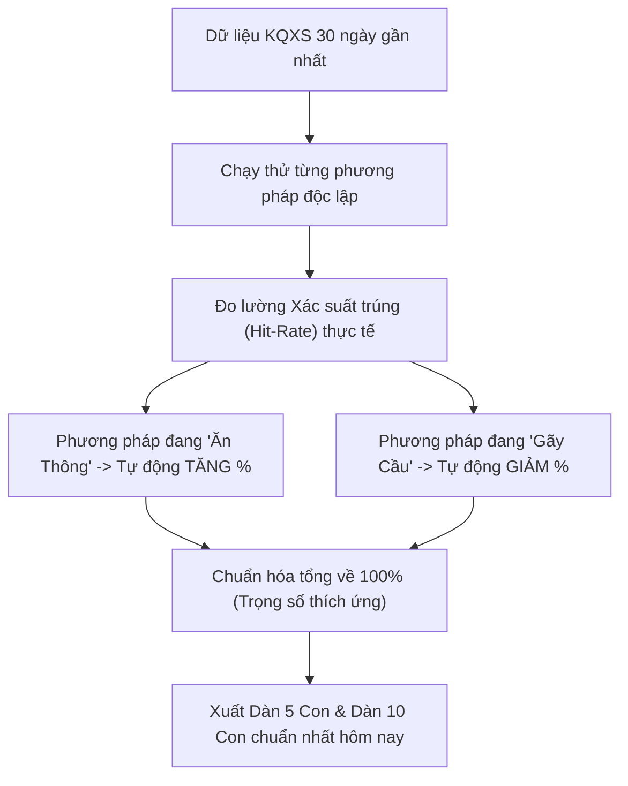

# KẾ HOẠCH & TÀI LIỆU DỰ ÁN: HỆ THỐNG GỢI Ý & GIẢ LẬP ĐIỂM LÔ TÔ 27 GIẢI (XSMB)

> **Mục tiêu:** Xây dựng ứng dụng web cao cấp, giao diện Dark Mode hiện đại (tối ưu điện thoại & máy tính), tích hợp **Bộ lọc trọng số đa mô hình (Multi-Model Weighting)**, gợi ý Dàn 5 con & Dàn 10 con, tra cứu backtest ngày cũ và **Giả lập vào điểm theo gợi ý (1 điểm 23k ăn 80k)**.

---

## 📌 I. Quy chuẩn & Thông số Thiết lập

### 1. Thông số Cược & Giả lập Tài chính
- **Tiền vốn:** 1 điểm = **23.000 VNĐ**.
- **Doanh thu khi trúng:** 1 điểm trúng (1 nháy) = **80.000 VNĐ** (Tổng tiền nhà cái trả về).
- **Lợi nhuận ròng trên mỗi điểm trúng:** `80.000 - 23.000 = 57.000 VNĐ / điểm` (chưa bù trừ các con xịt trong dàn).
- **Công thức tính dòng tiền cho cả dàn:**
  - **Tổng vốn bỏ ra:** `Tổng số con × Số điểm/con × 23.000 VNĐ`.
  - **Tổng doanh thu nhận về:** `Tổng số nháy trúng × Số điểm/con × 80.000 VNĐ`.
  - **Lợi nhuận ròng (Lãi/Lỗ):** `Tổng doanh thu - Tổng vốn`.
    - *Ví dụ 1 (Đánh Dàn 5 con, mỗi con 5 điểm = 25 điểm):*
      - Tổng vốn: $25 \times 23.000đ = 575.000đ$.
      - Nổ 2 nháy (trúng $2 \times 5 = 10$ điểm): Doanh thu = $10 \times 80.000đ = 800.000đ$.
      - **Lợi nhuận:** $800.000đ - 575.000đ = +225.000đ$ (Lãi Xanh).
    - *Ví dụ 2 (Đánh Dàn 5 con, mỗi con 5 điểm, nổ 1 nháy):*
      - Doanh thu = $5 \times 80.000đ = 400.000đ$.
      - **Lợi nhuận:** $400.000đ - 575.000đ = -175.000đ$ (Lỗ Đỏ).
    - *Ví dụ 3 (Đánh Dàn 5 con, nổ 0 nháy):*
      - **Lợi nhuận:** $-575.000đ$ (Mất toàn bộ vốn).
- **Hành vi người dùng:** Người dùng **không cần nhập số tự do**, mà **đánh trực tiếp theo Dàn gợi ý (Dàn 5 con hoặc Dàn 10 con)**:
  - Chọn Dàn (5 con hoặc 10 con).
  - Nhập số điểm mỗi con (ví dụ: 5 điểm/con $\rightarrow$ Dàn 5 con = 25 điểm = 575.000đ vốn).
  - Hệ thống tính toán lãi/lỗ tức thì dựa trên kết quả mở thưởng.

---

## 🎛️ II. Bộ Trọng Số Động Thông Minh (Adaptive Weighting - Dựa 100% Trên Xác Suất Ngày Cũ)

Thay vì đặt trọng số cố định một cách cảm tính, hệ thống sẽ **tự động chạy kiểm chứng (backtest) trên dữ liệu các ngày gần nhất (15 - 30 ngày qua)** để tính xác suất trúng thực tế của từng phương pháp rồi **tự động chia tỷ lệ % tương ứng**:

### 1. Cơ chế Tự Động Chia Tỷ Lệ Theo Phong Độ (Hit-Rate Based)
- **Đo lường độ hiệu quả:** Mỗi ngày trước giờ quay số, thuật toán quét lại 30 kỳ mở thưởng gần nhất:
  - Xem phương pháp *Cầu ghép vị trí* trong 30 ngày qua cho xác suất nổ bao nhiêu %.
  - Xem phương pháp *Nhịp rơi chuỗi thời gian* nổ bao nhiêu %.
  - Xem *Bắt theo đầu câm / đuôi câm* nổ bao nhiêu %.
  - Xem *Cặp đi cùng nhau* nổ bao nhiêu %.
- **Công thức chia tỷ lệ trọng số:**
  $$W_i = \frac{P_i}{\sum P} \times 100\%$$
  *(Trong đó $P_i$ là tỷ lệ trúng thực tế của phương pháp $i$ trong các ngày trước, tổng các $W_i$ tự động chuẩn hóa về đúng $100\%$)*.
- **Lợi ích vượt trội:**
  - **Hoàn toàn khách quan:** Máy tự tính theo số liệu thật, không phán đoán bừa bãi.
  - **Bắt kịp phong độ:** Cầu nào đang ăn thông thì máy tự dồn tỷ lệ vào cầu đó; cầu nào đang gãy thì máy tự động né ra.

---

### 2. Ba Chế Độ Gợi Ý 1-Click (Bấm 1 Nút Là Xong)

Người dùng chỉ cần bấm chọn 1 trong 3 nút chiến thuật, hệ thống tự nạp trọng số tương ứng:

1. 🛡️ **Chế Độ An Toàn (Mặc định - Khuyên Dùng):**
   - Trọng số chuẩn như bảng trên.
   - Mục tiêu: Giữ vốn ổn định, dàn 5 con hoặc 10 con ăn đều từ 1 đến 2 nháy trở lên để có lãi.
2. 🔥 **Chế Độ Bắt Cầu Thông (Săn Cầu Đẹp):**
   - Đẩy mạnh trọng số *Cầu Ghép Vị Trí (45%)* và *Nhịp Rơi (30%)*.
   - Mục tiêu: Bám theo các đường cầu đang chạy mượt nhất.
3. 💥 **Chế Độ Săn Nháy (Ưu Tiên Lô Rơi):**
   - Đẩy mạnh *Tần Suất Rơi Dày (40%)* và *Cặp Đi Cùng (30%)*.
   - Mục tiêu: Bắt các con số có khả năng nổ 2 nháy để tối đa hóa lợi nhuận ($57k \times 2 = 114k$/điểm).
4. ⚙️ **Mục "Tùy Chỉnh Nâng Cao" (Ẩn trong nút xổ xuống):**
   - Chỉ mở ra khi ai thích tự tay kéo thanh trượt, còn bình thường người dùng không cần bận tâm.

---

## 📅 III. Kiểm Tra, Backtest & Thống Kê Xác Suất Dàn 5 / Dàn 10 Ngày Cũ

Đây là tính năng cốt lõi giúp bạn **"nhìn thấy tận mắt xác suất thực chiến"**:

### 1. Bảng Đo Lường Xác Suất Thực Tế (Win-Rate Dashboard)
- **Tỷ lệ trúng của Dàn 5 con qua các ngày:**
  - Xác suất nổ $\ge 1$ nháy: Bao nhiêu % số ngày có ăn.
  - Xác suất nổ $\ge 2$ nháy (**ngưỡng bắt đầu CÓ LÃI**): Bao nhiêu % số ngày đạt lợi nhuận dương.
  - Trung bình mỗi ngày dàn 5 con về bao nhiêu nháy.
- **Tỷ lệ trúng của Dàn 10 con qua các ngày:**
  - Xác suất nổ có lãi của Dàn 10 con (cần $\ge 3$ nháy để bắt đầu có lãi).
  - Tỷ lệ bao phủ và số ngày ăn thông liên tiếp.

### 2. Xem Chi Tiết Từng Ngày Trong Quá Khứ (Time-Travel Inspector)
- Cho phép chọn bất kỳ ngày nào trong lịch sử:
  - Hệ thống áp dụng thuật toán trọng số động để sinh ra **Dàn 5 con** và **Dàn 10 con** của ngày đó (chỉ dựa vào dữ liệu trước đó).
  - So khớp ngay với bảng 27 giải thực tế:
    - Bôi xanh sáng rực các con đã trúng (ghi rõ: `Nổ 1 nháy`, `Nổ 2 nháy`...).
    - Thể hiện rõ: Trúng bao nhiêu con / dàn (ví dụ: Dàn 5 con trúng 2/5 con, tổng 3 nháy).
    - Tính luôn kết quả tài chính: Đánh 5 điểm/con thì ngày hôm đó **LÃI hay LỖ bao nhiêu tiền**.

---

## 💰 IV. Chức Năng Đỉnh Cao: Gợi Ý Vào Điểm & Tối Ưu Vốn (Gỡ Vốn Thông Minh)

Tính năng giải quyết trực tiếp bài toán bạn vừa nêu: **"Hôm nay trượt thì ngày mai vào bao nhiêu điểm để vừa bù lỗ vừa có lãi?"**

### 1. Cơ chế Quản lý Vốn Khung 2 - 3 Ngày (Smart Staking Plan)
- **Nguyên tắc toán học:** Nếu Ngày 1 không may bị trượt, hệ thống **không tăng điểm mù quáng**, mà tính toán chính xác mức điểm tối thiểu của Ngày 2 để:
  $$\text{Doanh Thu Ngày 2} > (\text{Vốn Ngày 1} + \text{Vốn Ngày 2}) + \text{Mục Tiêu Lãi Kỳ Vọng}$$
- **2 Lựa chọn Khung gỡ vốn:**
  - **Khung 2 Ngày (Nhanh, gỡ dứt điểm):** Dành cho ai muốn về bờ ngay hôm sau.
  - **Khung 3 Ngày (Chia nhỏ vốn, an toàn cao):** Tăng nhẹ điểm theo tỷ lệ `1 - 2.5 - 6` để giảm áp lực vốn.

### 2. Kịch bản Gợi Ý Thực Tế Trực Quan Trên Web
- **Hôm nay (Ngày 1):** Bạn đánh Dàn 5 con $\times$ 5 điểm/con = 25 điểm (Vốn $575.000đ$). Bị trượt $\rightarrow$ Lỗ $-575.000đ$.
- **Sáng mai (Ngày 2):** Hệ thống tự động phát hiện hôm qua âm $-575.000đ$ và hiện ngay bảng **"Gợi Ý Vào Điểm Ngày 2"**:
  > 💡 **Khuyến nghị Ngày 2:** Đánh Dàn 5 con mới với mức **12 điểm/con** (Tổng vốn Ngày 2 = $1.380.000đ$).  
  > - **Nếu nổ 2 nháy:** Doanh thu $24 \text{ điểm} \times 80k = 1.920.000đ$.  
  >   $\rightarrow$ Lợi nhuận tổng 2 ngày: $1.920k - (575k + 1.380k) =$ **LÃI DƯƠNG +35.000đ**.  
  > - **Nếu nổ 3 nháy:** Doanh thu $36 \text{ điểm} \times 80k = 2.880.000đ$.  
  >   $\rightarrow$ Lợi nhuận tổng 2 ngày: **LÃI ĐẬM +925.000đ**.
- **Cơ chế Cắt Lỗ An Toàn (Stop-Loss Protection):**
  - Khung tối đa chỉ 3 ngày. Nếu hết 3 ngày mà dây đen quá dài, hệ thống khuyên dừng và reset về lại Ngày 1 (mức cược cơ sở) để **tuyệt đối không bao giờ bị cháy tài khoản**.

---

## 📊 V. Module Thống Kê & Soi Lô Chuyên Sâu (Lô Khan, Lô Về Nhiều, Lô Rơi)

Khu vực tra cứu chuyên sâu dành cho người chơi muốn phân tích kỹ từng con số:

### 1. 🔥 Bảng Soi Lô Về Nhiều (Lô Hot / Phong Độ Cao)
- **Top 10 con nổ nhiều nhất:** Lọc theo các khung 30 ngày, 60 ngày, 90 ngày.
- **Chi tiết nháy:** Thống kê số lần nổ 1 nháy, 2 nháy, 3 nháy của từng con số.
- **Biểu đồ nhiệt (Heatmap 00 - 99):** Bảng ma trận 100 số với dải màu trực quan (con nào nổ nhiều rực màu Đỏ/Cam, con nào về bình thường màu Xanh ngọc, con nào ít về màu Xám đậm).

### 2. ⏳ Bảng Soi Lô Khan (Lô Gan - Lâu Chưa Xuất Hiện)
- **Top Lô Gan Đỉnh Điểm:** Danh sách các con số nhiều ngày nhất chưa ra.
- **So sánh Kỷ lục Gan (Max Gan):** So sánh số ngày khan hiện tại với kỷ lục khan cực đại trong lịch sử của con số đó.
- **Hệ thống Đèn Cảnh Báo Gan:**
  - 🔴 **Vùng Nguy Hiểm (Gan 10 - 18 ngày):** Khuyên **TUYỆT ĐỐI NÉ TRÁNH**, không cố đấm ăn xôi nuôi số gan vì dễ cháy vốn.
  - 🟡 **Vùng Chạm Đỉnh (Sát ngưỡng hoặc vượt kỷ lục Max Gan):** Báo động con số có xác suất sắp phá gan.
- **Cặp Lô Khan Cùng Nhau:** Thống kê cả cặp số lộn cùng chưa về (ví dụ cặp `27 - 72`).

### 3. ⚡ Bảng Soi Lô Rơi (Lô Bệt) & Đầu/Đuôi Câm
- **Tỷ lệ Lô Rơi:** Thống kê trong 27 con vừa về hôm qua, con nào có xác suất rơi lại hôm nay cao nhất.
- **Bắt Theo Đầu Câm / Đuôi Câm:** Kỳ trước câm đầu nào, đuôi nào $\rightarrow$ Thống kê các con số chạm đầu/đuôi đó hay nổ nhất trong lịch sử.

---

## 🎨 VI. Thiết kế Giao diện (UI/UX Sang Trọng)

- **Phong cách:** Giao diện **Dark Theme** (nền tối sang trọng, bo góc mềm mại, thanh trượt neon xanh cyan / tím giống ảnh bạn gửi).
- **Tối ưu Mobile-First:** Hiển thị trực quan, thao tác 1 chạm trên điện thoại (iPhone, Android) và co giãn mượt trên máy tính.
- **Các phân khu chính:**
  1. **Header & Chọn Ngày:** Ngày hôm nay hoặc chọn ngày cũ để kiểm tra.
  2. **Bảng Gợi Ý Hôm Nay (Hero Section):**
     - Thẻ Dàn 5 con (Điểm xác suất cao nhất).
     - Thẻ Dàn 10 con (Bao phủ an toàn).
     - Nút nhanh: *"Vào điểm dàn này"* (nhập 5 điểm/con $\rightarrow$ xem trước vốn/lời dự kiến).
  3. **Bộ Điều Chỉnh Trọng Số (8 Thanh Trượt Sliders):** Kéo thả mượt mà, tự động cân đối tổng 100%.
  4. **Bảng Kết Quả 27 Giải & Thống Kê Nhanh:** Bảng 2 số cuối, đầu/đuôi, nháy trúng.
  5. **Bảng Nhật Ký Lãi / Lỗ (PnL Dashboard):** Biểu đồ vốn, tổng lãi/lỗ theo tuần/tháng.

---

## 📋 VII. Nhật Ký & Trạng Thái Triển Khai Thực Tế

- [x] **Giai đoạn 1: Chuẩn bị CSDL & Thu thập dữ liệu lịch sử**
  - Đã nạp thành công **2.447 kỳ mở thưởng thực tế (từ 01/01/2020 đến 01/11/2026)** vào [data/xsmb_history.json](file:///d:/OneDrive/Vũ%20Đức%20Long/2.Documents/+-%2Fdata%2Fxsmb_history.json).
  - Tích hợp ô chọn ngày trực tiếp (Time-Travel) cho phép tua về bất kỳ ngày nào trong 6 năm qua.
  - Kỷ lục Max Gan của 100 số được tính toán 100% dựa trên số liệu thực tế qua gần 7 năm lịch sử.
  - **Mới:** Thêm Tab **"📜 Sổ Kết Quả 27 Giải (Theo Tháng)"** xem toàn bộ 27 giải của từng ngày theo vòng lặp 1 tháng, kèm tính năng soi và highlight số bất kỳ.
- [x] **Giai đoạn 2: Lập trình Engine Thống Kê & Chấm Điểm Đa Mô Hình**
  - Đã hoàn thành trong [js/engine.js](file:///d:/OneDrive/Vũ%20Đức%20Long/2.Documents/+-%2Fjs%2Fengine.js): Soi Lô Khan (phân vùng cảnh báo đỏ/vàng), Soi Lô Hot, Ma trận Heatmap 100 số, Lô Rơi & Đầu Câm/Đuôi Câm.
- [x] **Giai đoạn 3: Trọng số Động (Adaptive Weighting) & Sinh Dàn 3, Dàn 4, Dàn 5, Dàn 10**
  - Tự động đo lường xác suất các ngày quá khứ để chia tỷ lệ % tối ưu và xếp hạng sinh ra **Dàn 3 con (Tam thủ)**, **Dàn 4 con (Tứ thủ)**, **Dàn 5 con** & **Dàn 10 con**.
- [x] **Giai đoạn 4: Module Giả Lập Điểm & Tự Nhập Số Linh Hoạt**
  - Chuẩn quy tắc 1 điểm 23k vốn, ăn 80k doanh thu (lãi 57k).
  - Cho phép người chơi bấm chọn nhanh: **Dàn 3 con**, **Dàn 4 con**, **Dàn 5 con**, **Dàn 10 con** HOẶC **✏️ Tự nhập số tùy thích** (ví dụ: `23, 68, 86, 99...`).
  - Tự động tính vốn, nháy nổ, đối chiếu từng con trúng/trượt và tính Lãi/Lỗ ròng tức thì.
- [x] **Giai đoạn 5: Backtest Time-Travel Trên Các Ngày Quay Cũ**
  - Cho phép chọn bất kỳ ngày cũ nào, đo lường tỷ lệ nổ $\ge 1$ nháy, tỷ lệ có lãi $\ge 2$ nháy và chi tiết từng ngày.
- [x] **Giai đoạn 6: Giao Diện Dark Mode (Mobile + Desktop)**
  - Đã xuất bản giao diện hoàn chỉnh [index.html](file:///d:/OneDrive/Vũ%20Đức%20Long/2.Documents/+-%2Findex.html) kèm file chạy 1-click [MO_UNG_DUNG.bat](file:///d:/OneDrive/Vũ%20Đức%20Long/2.Documents/+-%2FMO_UNG_DUNG.bat) và script cập nhật [update_results.ps1](file:///d:/OneDrive/Vũ%20Đức%20Long/2.Documents/+-%2Fupdate_results.ps1).
  - **Tối ưu Mobile Chuyên Sâu:** Tích hợp thanh điều hướng dưới đáy màn hình (Bottom Navigation Bar) thao tác bằng ngón tay cái, hỗ trợ PWA chuẩn "Thêm vào màn hình chính" (Add to Home Screen) toàn màn hình như App thật.
  - **Máy chủ kết nối Điện Thoại 1-Chạm:** Tạo file [CHAY_CHO_DIEN_THOAI.bat](file:///d:/OneDrive/Vũ%20Đức%20Long/2.Documents/+-%2FCHAY_CHO_DIEN_THOAI.bat) giúp mở web ngay trên điện thoại qua Wi-Fi nội bộ.
